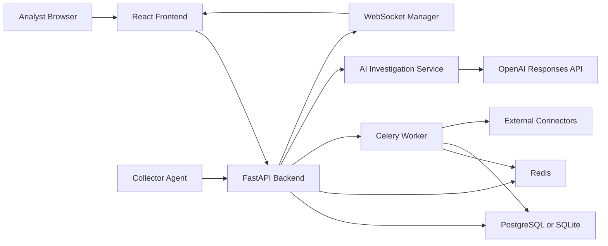
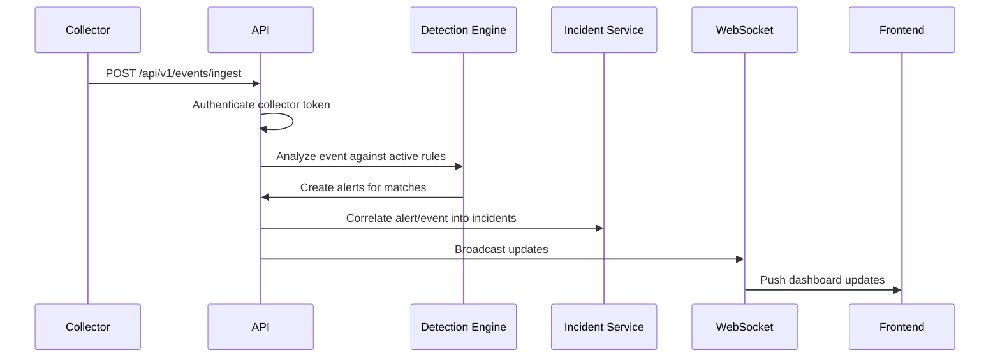
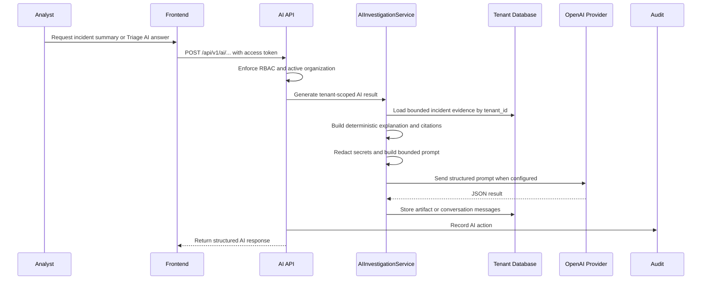

# TriageOps Architecture

Phase 7 separates stable detection identities from immutable content versions.
Only an explicit production version executes; matches retain exact version/hash
provenance. See [docs/PHASE7_DETECTION_ENGINEERING.md](docs/PHASE7_DETECTION_ENGINEERING.md).

## Commercial IOC boundary

Threat-source credentials use versioned authenticated encryption and redacted serializers.
TAXII/MISP, imports, bulk actions, hunts, and reports execute as bounded tenant-scoped jobs.
External HTTP requests revalidate every destination and redirect. IOC response items are
recommendations bound to the sensitive-action approval workflow; no recommendation executes
automatically. The relationship graph is a bounded relational projection with an accessible
table fallback. See `docs/IOC_INTELLIGENCE.md` and `docs/PHASE76_DEMO_READINESS.md`.

## Search and investigation boundary

Phase 6 keeps search inside SQLAlchemy/PostgreSQL/SQLite. A typed allowlist parser produces an AST that becomes only parameterized ORM expressions after tenant and permission scope. Entity extraction is bounded downstream ingestion work; schedules and export jobs revalidate tenant context. See `docs/PHASE6_SEARCH_INVESTIGATIONS.md`.

## Audit and data-protection boundary

Security and administrative events flow through the central audit service, which
normalizes taxonomy, recursively sanitizes metadata, and appends tenant-sequenced
HMAC chain records. Retention workers archive only a contiguous eligible chain
prefix and honor active legal holds. Export workers read through the same tenant
filter builder and write opaque, expiring artifacts. Sensitive MFA and connector
values use versioned authenticated encryption; keys remain runtime configuration.
See `docs/PHASE4_AUDIT_DATA_PROTECTION.md`.

This document describes the architecture implemented in the current repository. It intentionally avoids future-only services and roadmap claims.

## System Overview

TriageOps is a modular SOC operations platform made of four runtime areas:

- Backend API and worker.
- React analyst frontend.
- Python collector agent.
- PostgreSQL or SQLite database plus Redis for rate limiting, broker, and cache-style services.

The backend owns authentication, RBAC, collectors, event ingestion, detection rules, alerts, incidents, IOC enrichment, playbooks, SOAR response actions, AI investigation assistance, WebSocket updates, health checks, structured logs, and Prometheus metrics.

## Backend

The backend is a FastAPI application under `backend/src`.

Key areas:

- `api/v1`: REST endpoints and dependency wiring.
- `core`: configuration, database setup, security helpers, logging, metrics, and error helpers.
- `models`: SQLAlchemy database models and Pydantic API models.
- `services`: detection, incidents, threat intelligence, LLM provider, AI investigation context/prompt/report generation, playbooks, SOAR action orchestration, WebSocket broadcasting, and audit behavior.
- `connectors`: pluggable SOAR connector implementations behind a common base contract.
- `workers`: Celery application and background task entry points.

The backend is deployed as a modular monolith. It is split by domain inside the codebase but runs as one API service plus a worker process.

## Data Stores

Supported persistence modes:

- SQLite for local development and lightweight verification.
- PostgreSQL for Docker and production-style deployments.

Redis is used for production-style rate limiting and worker/broker communication. Development can use a Redis mock mode when explicitly configured.

Alembic owns schema migrations. The migration graph supports both SQLite and PostgreSQL compatibility for the implemented schema.

Indexes are tenant-aware on high-volume tables and cover common filters such as status, severity, timestamps, collector IDs, incident IDs, event IDs, and audit resources. This keeps the current modular monolith viable for larger datasets before introducing separate search or analytics stores.

## Authentication

The implemented authentication model includes:

- JWT access tokens.
- Database-backed refresh tokens.
- Hashed refresh tokens.
- Token rotation.
- Token family tracking.
- Logout and logout-all revocation.
- Password change with previous-session invalidation.
- Account lockout after repeated failed login attempts.
- Login timestamp and failed-login tracking.

Collector authentication is separate from user authentication. Collectors use bearer tokens that are verified against stored token hashes.

## Authorization

Tenant authorization is permission-based and resolved from the active
`OrganizationMembership`; `User.role` is retained only for platform/bootstrap
compatibility. Signed access tokens bind the active tenant and session, and
route tenant identifiers must match that context. Service policies independently
protect ownership, final-owner state, role assignment, session revocation, API
key scopes, approvals, and resource tenant ownership. Frontend permission
visibility is usability only—the backend remains authoritative. The complete
model and route inventory are in `docs/AUTHORIZATION.md`.

RBAC roles are:

- `admin`
- `analyst`
- `responder`
- `viewer`

Protected routes use dependency-based role checks. Collector-only routes use collector authentication and do not accept ordinary user credentials.

## Multi-Tenancy

The database tenant model is the organization boundary. Batch 6 extends tenants with organization metadata, quotas, subscription fields, lifecycle status, memberships, invitations, and usage snapshots while preserving existing `tenant_id` API contracts.

Tenant isolation rules:

- User requests operate in the active organization stored on the authenticated user session.
- Tenant switching is allowed only for active organization memberships and returns a fresh token pair.
- Collector requests resolve tenant context from the collector token and reject disabled/deleted organizations.
- Organization IDs supplied in administration APIs are validated against membership before any data is returned or changed.
- Operational resources such as alerts, events, incidents, playbooks, SOAR connectors, credentials, executions, detection rules, collectors, threat intelligence, feedback, notifications, and audit logs remain scoped by `tenant_id`.

Organization roles are mapped to the existing platform RBAC roles for backward compatibility:

- `owner` and `administrator` map to `admin`.
- `soc_manager` and `analyst` map to `analyst`.
- `viewer` maps to `viewer`.

Invitations store only hashed invitation tokens and expire automatically when listed or accepted/rejected. Usage limits are enforced before user invitations and collector registration.

## Event Flow

## Observability

Structured backend logs are JSON and include:

- timestamp
- severity
- service
- request_id
- tenant_id
- user_id
- collector_id
- endpoint
- execution_time_ms
- message

Request IDs are accepted through `X-Request-ID` or generated at the API boundary. The same value is returned on responses and appears in API logs. Collector requests also send `X-Request-ID`.

Prometheus metrics are exposed at `/metrics` when enabled. Metrics cover API requests, authentication outcomes, collector heartbeat and ingestion, detection execution, alert creation, incident creation, WebSocket connections/events, Redis status, database latency, queue latency, and worker task execution time.

SOAR metrics additionally cover connector executions, connector failures, retries, timeouts, approval latency, and connector execution duration.

## Playbook and SOAR Architecture

Playbooks are versioned workflow definitions. Executions materialize each step into persisted execution-step rows so status, retries, timing, results, errors, approvals, and logs are auditable.

SOAR response actions are implemented as a separate domain:

- `ActionConnector`: tenant-scoped connector configuration.
- `ConnectorCredential`: encrypted connector secrets, referenced by ID.
- `ConnectorActionExecution`: action request, response, status, retry, duration, worker, correlation, and request metadata.
- `SOARActionApproval`: optional single or multi-role approvals before dangerous actions run.
- `ConnectorActionLog`: execution log stream.

Connector classes inherit from a common abstract base and expose `validate`, `execute`, `test_connection`, `health`, and `rollback`. The registry maps connector type names to connector classes, so future integrations such as Defender, CrowdStrike, ServiceNow, Jira, Splunk, Sentinel, Elastic, QRadar, and cloud providers can be added as new classes without changing playbook execution logic.

Implemented connector types are webhook, Slack, Microsoft Teams, SMTP email, and generic REST API. External credentials are encrypted at rest and never returned through API responses.

In production-style deployments, SOAR actions are queued to Celery and processed by workers. In local development, `USE_REDIS_MOCK=true` or `SOAR_TASK_ALWAYS_EAGER=true` executes tasks inline through the same service path.

WebSocket connections are tracked per tenant, cleaned up on send failures, and receive heartbeat messages after the configured idle interval. The in-memory connection manager is intentionally isolated behind a service boundary so Redis Pub/Sub can be added later without changing API routes.

## Triage AI Architecture

Triage AI is implemented as a tenant-aware investigation service, not a general chatbot. API routes under `/api/v1/ai` require authenticated users with analyst-level roles and resolve organization scope from the authenticated session.

Core service objects:

- `IncidentIntelligenceService`: creates and explains the event-to-rule-to-alert-to-incident provenance chain, alert contributions, entity lineage, evidence references, correlation context, and deterministic risk explanation.
- The incident-scoped Triage AI context builder exposes bounded, read-only, tenant-scoped views for incident summary, origin, alerts, events, detection matches, timeline, entities, IOCs, risk, MITRE mapping, notes, and audit history.
- `ContextBuilder`: remains available for non-conversational AI artifacts that use broader tenant investigation context.
- `PromptBuilder`: redacts sensitive fields, filters common prompt-injection phrases from telemetry/comments, bounds prompt size, and emits structured JSON prompts.
- `TimelineBuilder`: creates chronological incident timelines from stored evidence and response activity.
- `MitreMapper`: produces ATT&CK technique suggestions from investigation evidence.
- `RiskScorer`: calculates a deterministic evidence-based 0-100 risk score used by summaries and fallbacks.
- `ReportGenerator`: creates Markdown incident reports from summaries, timeline entries, and evidence counts.
- `ConversationMemory`: represented by persisted AI conversation and message tables scoped by tenant and incident.

Incident provenance is persisted only where history would otherwise be lost: creation source/reason, primary alert, correlation metadata, observed time window, risk breakdown, severity rationale, alert contribution fields, and normalized incident entities. Counts, source-event lists, detection references, timeline summaries, and evidence-reference lists are calculated from tenant-scoped relationships with bounded queries.

New detection and Playbook incidents are marked with recorded provenance. Direct ORM-created incidents default to manual provenance. Pre-tracking incidents are marked `legacy_derived`; dynamically reconstructed entities and timestamps are identified as derived, and unavailable historical correlation reasons are not fabricated. The detection alert that creates an incident is the deterministic primary alert for all APIs.

Generated summaries, explanations, IOC analysis, timelines, reports, detection suggestions, and playbook suggestions are stored as AI investigation artifacts. Triage AI chat messages are persisted separately so analysts can continue an incident-scoped conversation without exposing cross-tenant data.

Triage AI writes are idempotent. A client request ID is bound to the tenant, user, incident, conversation, and normalized question fingerprint. Redis coordinates in-flight requests across workers; a bounded process-local lock preserves retry safety when Redis is unavailable. While the first request is running, matching callers receive a conflict response. Once complete, authorized retries replay the persisted answer. Scope or fingerprint mismatches are rejected, provider failures leave no partial conversation pair, and failed requests release their lock for a safe retry.

OpenAI receives a bounded structured prompt, not an unrestricted database dump. The Triage AI context builder applies configurable collection limits, deterministic evidence ranking, deduplication, and a final serialized byte budget. Lower-priority collections are omitted before incident-origin, primary-alert, and evidence-reference facts. JSON is compacted as complete objects and is never truncated into invalid structures. Telemetry and analyst text are treated as untrusted content, credential-shaped values are redacted, and prompt-injection phrases are neutralized. Triage AI cannot run SQL, Python, shell commands, playbooks, SOAR actions, containment, or incident state changes. When OpenAI is not configured or unavailable, the service returns deterministic fallback analysis with the same evidence references and limitations.

Evidence-reference navigation is backend-authoritative. The frontend resolves each reference through the tenant-scoped incident evidence API before navigating. Deleted or unsupported evidence returns a safe not-found response, and a reference from another tenant cannot be resolved even when its identifier is known.

Provider availability is explicit in the response metadata. A deterministic response is marked as fallback and retains real evidence references; it is not represented as a live OpenAI answer. Provider quota or availability failures are categorized and are not retried without a new authorized request.

Incident Detail loads core incident data independently. Explanation, timeline, and IOC collections have separate loading and error states; timeline and IOC requests are lazy and cancelled when the page unmounts. Related alerts are paginated and compact by default, while complete event payloads remain available through event-detail APIs.

## Health Checks

Health endpoints:

- `/health/live`: process liveness.
- `/health/ready`: dependency readiness.
- `/health`: full health report including optional degraded providers.

Readiness checks include database, Redis, worker broker reachability, storage, migration status, AI provider configuration, and threat intelligence provider configuration.
The migration check compares `alembic_version` with the repository's single current head and makes readiness fail with HTTP 503 when the database is behind. Liveness remains dependency-free.

## Organization lifecycle and usage

Organization deletion is a state machine: `active` -> `pending_deletion` -> `deleted`, with cancellation returning `pending_deletion` to `active`. The transition to pending requires the owner PIN and disables normal user, collector, session, and API access. A configurable UTC purge time is stored on the organization. The idempotent purge service deletes tenant-owned operational rows in dependency order, disables primary users, clears PIN material, and retains the tenant tombstone plus audit evidence.

`organization_usage` stores one concurrency-safe aggregate per tenant and UTC date. Current resource counts are tenant-scoped indexed SQL counts; request middleware atomically increments API and Triage AI counters. Storage is a SQL aggregate of managed application payload lengths and does not represent infrastructure disk allocation.

## Frontend

The frontend is a Vite React application in `frontend/src`.

Implemented areas include:

- Login and authenticated API client.
- Automatic token refresh and logout handling.
- Dashboard.
- Alerts.
- Incidents.
- IOC views.
- Detection rules.
- Log sources and collectors.
- Playbooks.
- SOAR connectors, credentials, action history, and execution detail views.
- Triage AI dashboard, incident-scoped chat, AI reports, timeline viewer, alert explanations, IOC analysis, detection suggestions, and playbook suggestions.
- WebSocket-driven live updates.
- Password change UI.

The frontend reads `VITE_API_BASE_URL` for API routing. In production-style Docker, Nginx serves the static frontend and proxies API/metrics traffic.

## Collector Agent

The collector agent is a Python process under `collector-agent`.

It:

- Reads collector ID, token, and backend URL from environment.
- Sends authenticated heartbeats.
- Sends normalized event payloads.
- Sends `X-Request-ID` on backend calls.
- Writes structured JSON logs.
- Uses Windows-safe log rotation.

## Docker

Development Compose stack:

- Backend API.
- Backend worker.
- Frontend dev server.
- PostgreSQL.
- Redis.
- pgAdmin.

Production-style Compose stack:

- Backend API.
- Backend worker.
- Static frontend served by Nginx.
- PostgreSQL.
- Redis.
- Health checks.
- Non-root runtime users in production images.
- Required production secrets.

## API Conventions

API routes are grouped under `/api/v1`.

Errors use a standard response envelope:

- timestamp
- request_id
- status
- error_code
- message
- detail
- details
- documentation_url

Pagination is implemented on major list endpoints using limit/offset patterns where supported.

## Security Controls

Implemented controls include:

- Strong secret validation in production.
- Trusted host validation.
- CORS allow-listing.
- Security headers.
- Redis-backed rate limiting with graceful fallback.
- Hashed passwords.
- Hashed refresh tokens.
- Hashed collector tokens.
- Session revocation.
- Audit logging for authentication-sensitive actions.

## Current Boundaries

The repository is not yet a complete enterprise SaaS release. The following are intentionally outside the current released scope:

- Enterprise EDR/SIEM/ticketing connector packs beyond webhook, Slack, Teams, SMTP, and generic REST.
- SSO and SAML.
- Multi-region deployment.
- Dedicated search cluster.
- Object storage for evidence artifacts.
- Kubernetes manifests.

Those should be handled in later batches after the current platform foundation is fully verified.
