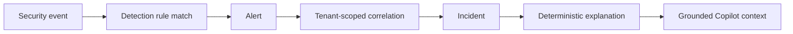

# Incident Intelligence and Copilot

This document describes the implemented incident provenance and incident-scoped AI behavior in TriageOps.

## Incident Creation

An incident can be created by detection and correlation workflows or by a Playbook step. ORM-created incidents default to a manual origin. Detection-created incidents retain the alert that first caused incident creation as their deterministic primary alert. Alerts added later retain their recorded correlation reason, score, sequence, risk contribution, matching entities and indicators, and time difference from the primary alert.

The incident record persists creation and correlation facts that would otherwise be lost. Source-alert counts, source-event counts, affected-entity counts, detection references, timeline entries, IOC references, and evidence links are calculated from current tenant-scoped relationships.

Provenance is explicitly labelled:

- `recorded`: provenance was captured when the incident was created or updated.
- `manual`: no automatic detection origin is claimed.
- `legacy_derived`: the incident predates detailed tracking. Derived display fields are identified, and the API states that the exact historical correlation reason is unavailable.

Legacy records are not rewritten with invented correlation facts.

## Explanation API

`GET /api/v1/incidents/{incident_id}/explanation`

The endpoint requires an authenticated `admin`, `analyst`, or `responder`. Tenant scope comes from the authenticated session; a client-supplied tenant ID is not accepted.

The response contains:

- Incident origin and creation reason.
- Primary and correlated alert contributions.
- Source events and detection-rule matches.
- Correlation key, score, window, and reasons.
- Chronological timeline summary.
- Evidence-backed users, hosts, IPs, processes, files, hashes, domains, URLs, email addresses, cloud resources, collectors, and log sources when present.
- IOC and MITRE ATT&CK references.
- Risk score breakdown and severity rationale.
- Evidence references, limitations, and recommended investigation questions.

Large alert and event collections are bounded by validated query limits. Existing incident and alert APIs remain unchanged.

The official risk score is deterministic. It combines base severity (low 10, medium 20, high 30, critical 40), bounded multiple-alert, suspicious-behavior, threat-intelligence, asset-criticality, MITRE-impact, and analyst-feedback factors. The breakdown includes the uncapped total and any bounding adjustment, so its numeric components always reconcile to the final 0-100 score. AI output cannot change the official score.

## Copilot Data Access

The Copilot may read only controlled views of the current incident:

- Summary and origin.
- Related alerts and source events.
- Detection matches.
- Timeline and entities.
- IOCs, risk factors, and MITRE mapping.
- Analyst notes and incident audit history.

It cannot perform arbitrary database queries, run code or shell commands, execute Playbooks or SOAR actions, close incidents, or take containment action. Recommendations always require analyst review.

## Grounding and Safety

Every answer returns an answer, evidence references, confidence, limitations, suggested follow-up questions, provider, model, generation time, request ID, and fallback status. References identify the incident, alert, event, IOC, entity, or stored evidence used to support the answer.

Conversation records belong to one tenant, incident, and user. Other users cannot retrieve that history through the conversation APIs. Prompts are size-bounded. Event payloads, alert text, IOC values, analyst questions, conversation history, and notes are structurally separated as untrusted content from provider system instructions. Sensitive dictionary fields and inline credential assignments are redacted, and common instruction-override phrases are neutralized before provider submission.

If OpenAI is unavailable, invalid, timed out, rate limited, or over quota, TriageOps returns deterministic analysis from the same authorized evidence. The response identifies the local fallback provider and retains citations and limitations.

## Environment

- `OPENAI_API_KEY`: optional in development and required by production runtime validation.
- `OPENAI_MODEL`: OpenAI model name; configured as `gpt-5.6-luna`.
- `OPENAI_TIMEOUT_SECONDS`, `OPENAI_MAX_OUTPUT_TOKENS`, and `OPENAI_REASONING_EFFORT`: bounded request controls.

No additional environment variables are required for incident provenance or deterministic fallback analysis.

## Demo Workflow

1. Ingest an event that matches an enabled detection rule.
2. Open the generated incident and review **How This Incident Was Created**.
3. Follow the displayed event, rule, alert, correlation, and incident chain.
4. Review the primary alert, correlated alerts, entities, IOCs, risk factors, MITRE mapping, evidence, and limitations.
5. Select **Open Copilot** and ask: `Why was this incident created?`
6. Open the cited alert or event below the answer.
7. Ask: `Which evidence supports the severity?` and `What should I investigate next?`
8. Temporarily omit `OPENAI_API_KEY` in a development environment to demonstrate that deterministic fallback analysis remains available.

The Copilot enhances the deterministic explanation; it does not replace or alter the underlying incident evidence.
